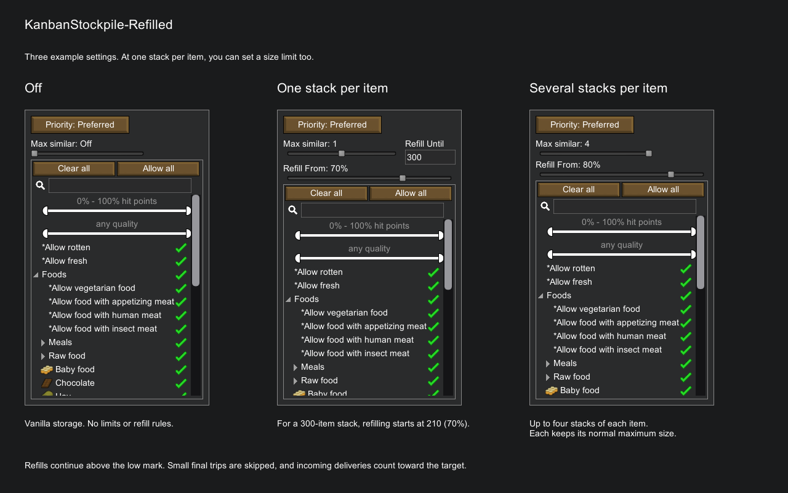

# KanbanStockpile-Refilled

Set how many stacks of each item a stockpile or shelf holds, and when pawns
refill them. With one stack per item, you can also set its size.

Refilled continues [KanbanStockpile Continued by Endag](https://steamcommunity.com/sharedfiles/filedetails/?id=3767756434),
based on the [original KanbanStockpile by ubergarm](https://steamcommunity.com/sharedfiles/filedetails/?id=2287142613).
This version supports **RimWorld 1.7** and requires **Harmony**. Enable Refilled
in place of either predecessor; their saved storage settings carry over.

[Refilled on Workshop](https://steamcommunity.com/sharedfiles/filedetails/?id=3832323892)

[Source code on GitHub](https://github.com/eiennohito/rimworld-kanbanstockpile-refilled)

## Storage controls

Select a stockpile or storage building and open its Storage tab.

- **Max similar** sets the number of stacks allowed for each item. **Off** leaves
  hauling to that storage unchanged.
- With **Max similar = 1**, **Refill Until** sets the stack size. Leave it empty
  for **Max Stack**, the item's usual maximum. It can lower that maximum, not
  raise it.
- **Refill From** sets how low a stack must get before pawns refill it.
  **100%** allows normal top-ups. After refilling starts, pawns continue above
  the threshold; they may skip a small final top-up.

For example, set a steel stack to 60 and Refill From to 50%. Pawns start
refilling at 30 steel or fewer. Deliveries already on their way count toward
the limit.

Click Refill Until to replace its value. Enter or clicking elsewhere saves it;
Escape cancels. An empty field restores Max Stack. Scroll over a number to change
it by one. The Max similar slider also accepts the mouse wheel and arrow keys.

## Compatibility and limits

Works with stockpiles, vanilla shelves and Adaptive Storage.

With **Pick Up And Haul Reworked**, pawns can bring several stacks for limited
storage in one trip, including food, hay and cloth. With original PUAH or Mlie's
version, storage with limits uses ordinary hauling. Construction deliveries
are unchanged.

Multiplayer is not supported. After loading a save, a partly filled stack may
refill once before it resumes waiting for the chosen threshold. RimWorld may
warn about the changed mod list when replacing a predecessor.

[Purpose and limits](PURPOSE.md)

## Screenshots

[Size limit and threshold](Screenshots/02-single-stack.png) ·
[Refill cycle](Screenshots/03-refill-cycle.png) ·
[Mod options](Screenshots/04-mod-options.png)

## Credits and development

Original mod by ubergarm; continued by Endag, with contributions from Tmq5521
and bananasss00. Refilled is maintained by eiennohito and uses the [MIT license](LICENSE).

[Build and test instructions](BUILDING.md) · [Implementation notes](DESIGN.md)
